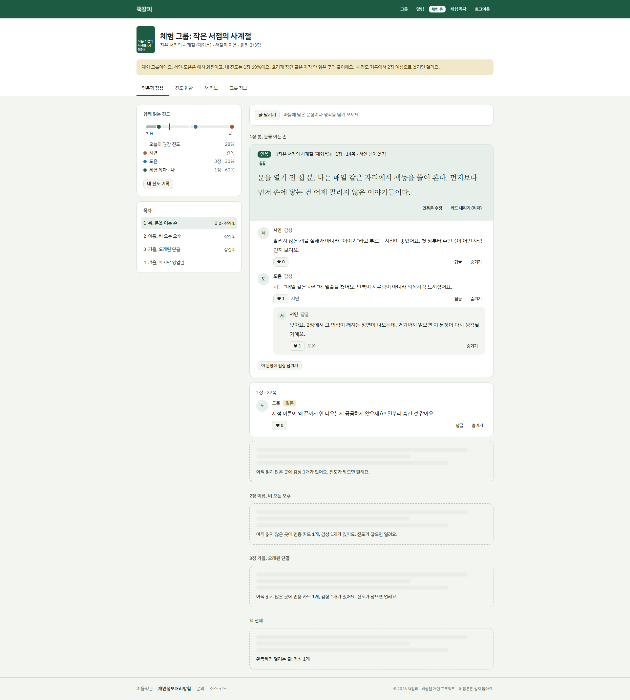
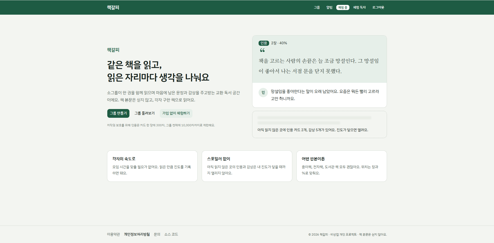
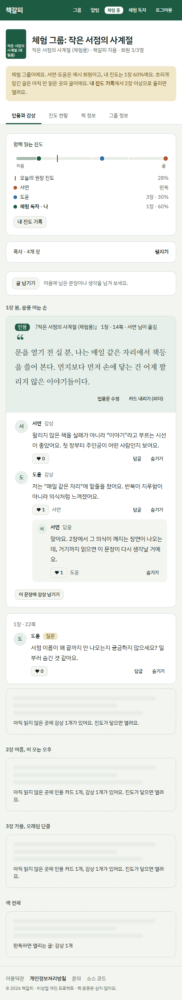
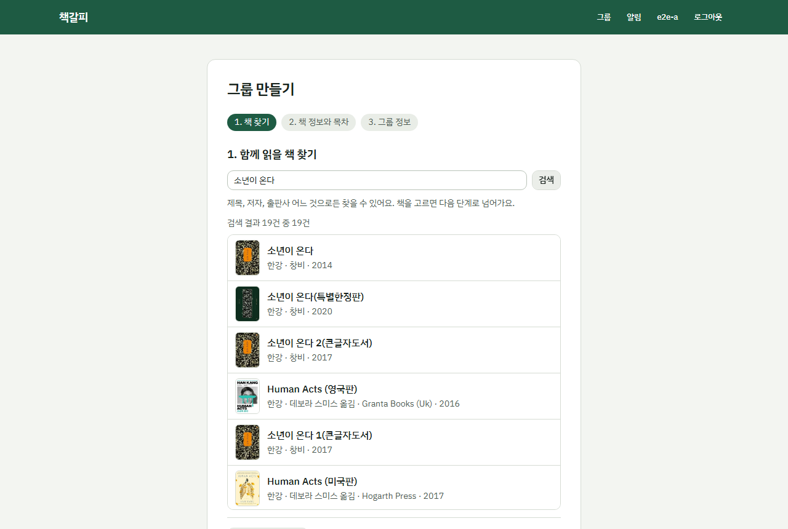
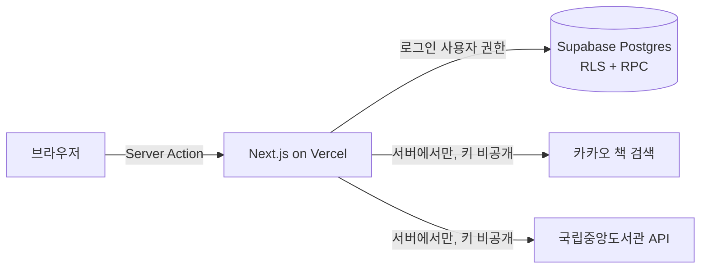

# 책갈피

같은 책을 읽는 소그룹이 **읽은 위치마다** 인용과 감상을 나누는 교환 독서 웹 서비스입니다.
각자의 속도로 읽어도, 아직 읽지 않은 곳의 글은 내 진도가 닿을 때까지 열리지 않아 스포일러 걱정이 없습니다.

**배포 주소:** https://chaekgalpi-tau.vercel.app/  
가입 없이 첫 화면의 **가입 없이 체험하기**를 누르면, 예시 회원 두 명과 글이 채워진 체험 그룹에서 바로 써 볼 수 있습니다.(그룹 만들기 기능은 회원가입 후에만 가능합니다.)



| 첫 화면 | 모바일 교환 독서 | 그룹 만들기 |
| --- | --- | --- |
|  |  |  |

## 핵심 기능

- **진도 잠금:** 내 진도(장 + 장 안 위치)보다 뒤에 달린 인용·감상은 내용 없이 "몇 개 있어요"만 흐리게 보입니다. 진도를 올리면 열립니다.
- **인용 카드와 감상:** 마음에 남은 문장을 카드로 남기고, 회원들이 그 카드에 감상·답글·좋아요를 답니다. 입력하는 동안 비슷한 카드가 이미 있으면 알려 줘 중복을 줄입니다.
- **쪽수 또는 %로 위치 입력:** 목차의 시작 쪽과 전체 쪽수를 알면 쪽수로, 모르면 장 + %로 위치를 정합니다. 판본이 달라도 목차 기준으로 맞춥니다.
- **책 검색과 목차 자동 채움:** 카카오 책 검색으로 표지와 서지 정보를, 국립중앙도서관 API로 목차와 쪽수를 가져옵니다. 없으면 직접 입력합니다. 같은 책에 회원들이 저장한 목차가 여러 벌이면 많이 쓰이는 순서로 추천하고, 그대로 쓰거나 바탕으로 고쳐 새 목차를 만들 수 있습니다.
- **그룹 운영:** 3단계 그룹 만들기, 초대 링크, 공개 그룹 검색, 입장 전 그룹 소개, 읽는 기간 달력과 오늘의 권장 진도, 리더의 회원·글 관리, 앱 안 알림
- **토론 준비:** 고른 장 범위에서 답을 기다리는 질문, 공감을 많이 받은 감상, 이야기가 많은 문장, 장별 글 양, 회원별 참여를 모아 독서 모임 준비를 돕습니다. 내가 아직 안 읽은 곳의 글은 빠지고, 범위를 다 읽지 않은 회원은 따로 알려 줍니다
- **감상문 도우미:** 내가 남긴 인용과 감상을 감상문 뼈대(도입 → 인상 깊은 장면 → 생각의 변화 → 맺음)에 맞춰 초안으로 모아 주고, 고쳐 쓴 뒤 복사할 수 있습니다
- **저작권 보호 장치:** 책 본문은 싣지 않습니다. 인용은 카드당 300자, 그룹 합계 10,000자까지이고 감상 없이는 등록할 수 없습니다.

## 기술 스택

| 영역 | 사용 기술 |
| --- | --- |
| 프런트·서버 | Next.js 16 (App Router, Server Actions, Cache Components), React 19, TypeScript strict |
| UI | Tailwind CSS v4, shadcn/ui (Base UI), 모바일 우선 반응형 |
| DB·인증 | Supabase (Postgres, Row Level Security, RPC, Auth: 이메일·구글·익명) |
| 검증 | Zod (서버 입력과 화면 폼이 같은 스키마) |
| 테스트 | Vitest + Testing Library, Playwright(모바일·데스크톱), pgTAP |
| 외부 API | 카카오 책 검색, 국립중앙도서관 서지정보 |
| 배포·CI | Vercel, GitHub Actions |



## 설계에서 신경 쓴 점

**1. 스포일러 잠금은 화면이 아니라 DB가 지킵니다.**
아직 읽지 않은 위치의 글은 RLS 정책(`can_see`)이 조회 결과에서 아예 빼므로, 개발자 도구로 응답을 열어 봐도 내용이 없습니다. 화면의 흐린 자리는 내용 없이 개수만 돌려주는 RPC(`locked_counts`)로 그립니다.

**2. 위치는 "목차의 (장, 장 안 %)" 한 가지로 저장합니다.**
판본마다 쪽수가 달라도 같은 장면을 가리키도록 했습니다. 쪽수 입력은 화면과 DB 함수(`page_to_position`)에서 (장, %)로 바꾸고, 저장한 위치는 다시 같은 쪽으로 되돌아오도록 단위 테스트로 확인합니다.

**3. 비밀 키 없이, 모든 데이터 접근을 로그인 사용자 권한으로 합니다.**
Supabase service_role 키를 쓰지 않습니다. 직접 쓰면 안 되는 동작(입장, 인용 등록, 리더 권한)은 `security definer` RPC로만 열고, 함수마다 `search_path`를 비우고 실행 권한을 최소로 줍니다. 테이블 쓰기 권한도 필요한 열에만 줍니다.

**4. 체험 모드도 DB 규칙으로 격리합니다.**
익명 로그인 사용자는 트리거와 restrictive 정책 때문에 체험 그룹 밖에서는 그룹·책을 만들거나 다른 그룹에 들어갈 수 없고, 체험 그룹에는 다른 사람이 들어올 수 없습니다. 오래된 체험 그룹은 다음 체험이 시작될 때 정리됩니다.

**5. 외부 API는 실패를 전제로 합니다.**
카카오와 국립중앙도서관 응답을 Zod로 검사하고, 한쪽이 실패해도 다른 쪽 정보나 직접 입력으로 이어집니다. 표지는 허용한 이미지 서버의 https 주소만 저장합니다.

**6. 오류 문구를 한곳에서 관리합니다.**
DB 함수는 `quote_limit_exceeded` 같은 영어 키를 던지고, 화면 문구는 `src/lib/errors.ts` 한 파일에서 한국어로 바꿉니다.

## 테스트와 CI

| 종류 | 범위 |
| --- | --- |
| 단위 (Vitest, 158개) | Zod 스키마, 목차 붙여 넣기 해석, 쪽수 ↔ 위치 환산, 일정 계산, 토론 준비 집계, 감상문 초안, 외부 API 응답 변환, 주요 폼 컴포넌트 |
| DB (pgTAP, 98개) | RLS 진도 잠금, 리더 권한, 인용 한도·수정 규칙, 그룹 미리 보기, 체험 모드 격리, 목차 버전 추천 순서 |
| E2E (Playwright) | 두 회원 흐름(그룹 생성 → 초대 입장 → 2장 카드 → 1장 독자에게 잠김 → 진도 2장 → 열림), 체험하기, 로그인 보호 경로 |

GitHub Actions가 PR마다 린트·포맷·타입 검사·단위 테스트·빌드, 로컬 Supabase를 띄운 pgTAP과 E2E를 돌리고, 모두 통과해야 `main`에 합칠 수 있습니다.

## 폴더 구조

```
src/
  app/                 화면(라우트)과 Server Action
    groups/[id]/       교환 독서 화면(피드·진도·책 정보·그룹 정보 탭)
    demo/              가입 없이 체험하기
  components/          화면 부품 (ui/는 shadcn)
  lib/
    validation/        Zod 스키마 (DB 제약과 같은 숫자)
    books/             목차 해석, 쪽수 ↔ 위치, 일정 계산
    kakao/ nlk/        외부 API 클라이언트와 응답 검사
    supabase/          서버·브라우저 클라이언트, 생성된 DB 타입
    errors.ts          오류 키 → 화면 문구
supabase/
  migrations/          DB 스키마·RLS·RPC (변경은 새 파일로만)
  tests/database/      pgTAP 테스트
e2e/                   Playwright 테스트
docs/PRD.md            제품 요구사항
```

## 내 컴퓨터에서 실행하기

Node.js 20.9 이상과 Supabase 프로젝트가 필요합니다.

```bash
npm install
cp .env.example .env.local   # Supabase URL·Publishable key, 카카오·국립중앙도서관 키를 채운다
npx supabase link            # 내 Supabase 프로젝트와 연결
npx supabase db push         # 마이그레이션 적용
npm run dev                  # http://localhost:3000
```

| 명령 | 하는 일 |
| --- | --- |
| `npm run lint` / `npm run format:check` / `npm run typecheck` | 린트 / 포맷 / 타입 검사 |
| `npm run test` | 단위 테스트 |
| `npm run test:e2e` | E2E 테스트 (`.env.local`의 `E2E_*` 값이 있으면 두 회원 흐름까지) |
| `npm run db:test` | pgTAP (Docker와 `npx supabase start` 필요) |

## 기획(PRD)과 달라진 점

[`docs/PRD.md`](docs/PRD.md)는 구현 전에 쓴 초안입니다. 직접 써 보며 아래처럼 바꾸거나 미뤘습니다.

| PRD | 실제 구현 | 이유 |
| --- | --- | --- |
| 국립중앙도서관 API로 책 검색 | 검색·표지는 카카오 책 검색, 목차·쪽수는 국립중앙도서관 | 도서관 검색은 정확도 및 인기도 순으로 결과가 나오지 않으며 저자 검색이 약했다. 알라딘 API는 서비스가 종료. |
| 목차로 위치 체계 구성 | 목차는 권장, 없으면 "책 전체의 %"로 동작 | 목차 자료가 있는 책이 적어 입력 부담이 컸다(PRD의 리스크 대응안을 기본 동작으로) |
| Supabase Realtime으로 즉시 반영 | 보류 | 각자의 속도로 읽는 비동기 교환이 핵심이라 MVP에서 효과가 작았다 |
| 이메일·웹 푸시 알림 | 앱 안 알림 | 메일 발송 서비스 없이 먼저 검증 |
| 주차별 읽기 범위 | 읽는 기간 달력과 오늘의 권장 진도 | 범위를 따로 정하지 않아도 기간만으로 페이스를 보여 줄 수 있었다 |
| 프로필의 지역(도서관 조회용), 서점·도서관 소장 링크, 읽고 싶은 책 목록 | 넣지 않음 | 꼭 필요하지 않은 개인정보는 받지 않기로 했고, 나머지는 핵심 흐름 검증 뒤로 미뤘다 |
| — | 추가: 가입 없이 체험하기, 그룹 설정(정보 수정·회원 관리·삭제), 리더의 인용 카드 관리, 공개 그룹 검색, 입장 전 그룹 소개, 쪽수로 인용 위치 입력 | 써 보며 필요해진 기능 |

## 앞으로 할 일

- 목차가 없는 책의 목차 입력 부담 줄이기
- 이메일·웹 푸시 알림, 주차별 읽기 범위
- 새 글 실시간 반영 재검토(구현은 `feat/m5-realtime` 브랜치에 보류)

## 만든 방법

기획(`docs/PRD.md`)과 작업 규칙(`AGENTS.md`)을 먼저 정하고, Claude Code와 마일스톤 단위로 구현했습니다. 마일스톤마다 테스트와 CI를 통과시킨 뒤 PR로 합쳤습니다.
